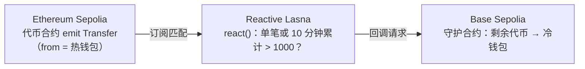

# D1 用例拆解卡：钱包守护

**场景：** 热钱包私钥被盗时，自动把另一条链上的剩余资产转到冷钱包。参考 Reactive 示例 approval-magic 和训练营场景手册「场景 2」。

**为什么需要跨链：** 同一个私钥在所有 EVM 链上通用。小偷拿到私钥后，偷完 Ethereum 上的币，下一步很可能去 Base 上偷。所以在 Ethereum 上发现异常时，要抢先把 Base 上的资产转走。

## 1. 监听哪条链、哪个合约的什么事件？

监听 **Ethereum Sepolia** 上一个测试代币合约的 `Transfer` 事件，只看**转出方是我的热钱包**的转账。

## 2. 满足什么条件时触发？

- 单笔转出超过 **1000 个代币**，**或者**
- **10 分钟内**累计转出超过 1000 个代币

第二个条件用来防止小偷把钱拆成很多笔小额转账，绕过单笔检查。

## 3. 在哪条链做什么动作？

在 **Base Sepolia** 上调用一个守护合约，把热钱包在 Base 上剩余的代币转到事先指定好的冷钱包。守护合约需要事先获得代币授权（approve）。

## 4. 不用 Reactive 怎么做？Reactive 简单在哪？代价是什么？

**不用 Reactive：** 要自己写程序，24 小时不间断地监听链上信息，发现异常再用私钥发交易。

**Reactive 简单在哪：**
- 不用自己运行服务器，电脑关机也能继续工作
- 一个合约就能持续监听 A 链、操作 B 链
- 规则写在合约里，公开透明，谁都可以检查

**代价：**
- 合约里要提前存 lREACT 付费，额度用完就停止工作
- 大约有 1 秒的延迟；如果小偷先去转移 Base 上的资产，守护可能来不及
- 已经转出的代币没有办法追回，只能保护其他链上剩下的资产
- 守护合约的权限必须写得很严格，只能转到冷钱包，否则它本身就会成为漏洞

## 简图

